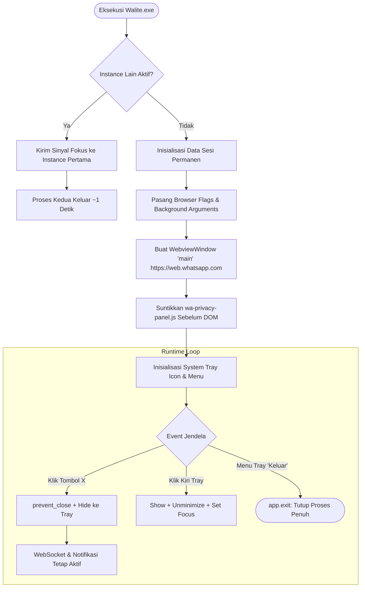
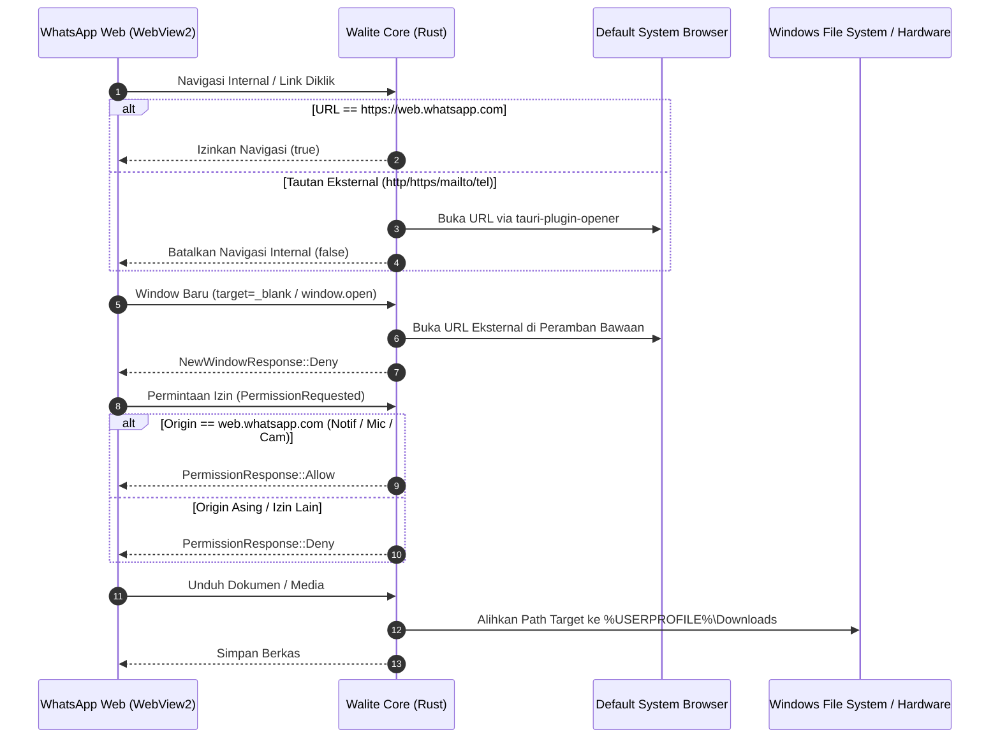

<div align="center">

# WALITE
### Lightweight, Secure & Privacy-Focused WhatsApp Web Wrapper for Windows 11

[](https://tauri.app)
[](https://www.rust-lang.org)
[-0078D4?style=for-the-badge&logo=windows&logoColor=white)](https://microsoft.com/windows)
[](https://developer.microsoft.com/microsoft-edge/webview2/)
[](https://github.com/ridho-novianto/walite/releases)
[](https://github.com/ridho-novianto/walite/releases)
[](LICENSE)

<p align="center">
  Aplikasi desktop wrapper WhatsApp Web resmi untuk Windows 11/10 yang dibangun di atas <b>Tauri v2</b> dan <b>Rust</b>. Dirancang secara presisi untuk meminimalkan beban memori (RAM), menjaga sesi login tetap permanen, serta dilengkapi suite proteksi privasi visual (CSS-only blur) dan pengunci layar mandiri (PBKDF2 SHA-256).
</p>

---

[Highlight & Benchmark](#-highlight--benchmark-performa) • [Fitur Utama](#-fitur-utama) • [Arsitektur Sistem](#-arsitektur-sistem) • [Struktur Proyek](#-struktur-proyek) • [Instalasi](#-instalasi--penggunaan) • [Kompilasi dari Source](#-kompilasi-dari-source) • [Panel Privasi & SELECTORS](#-panel-privasi--pembaruan-selectors) • [FAQ & Lisensi](#-faq-singkat)

---

</div>

## Highlight & Benchmark Performa

Dibandingkan wrapper berbasis Electron konvensional maupun membuka tab browser penuh, Walite memanfaatkan shared Windows WebView2 Runtime dengan argumen Chromium yang telah dioptimasi secara ketat untuk performa latar belakang (*background persistence*).

```text
┌────────────────────────────────────────────────────────────────────────┐
│                        PERBANDINGAN ARSITEKTUR                         │
├─────────────────────────┬────────────────────┬─────────────────────────┤
│ Metrik Evaluasi         │ Electron / Browser │ Walite (Tauri v2 + Rust)│
├─────────────────────────┼────────────────────┼─────────────────────────┤
│ Ukuran Installer (NSIS) │ ~85 MB - 160 MB    │ 1.14 MB (Sangat Ramping)│
│ Ukuran Biner (.exe)     │ ~120 MB - 220 MB   │ 3.24 MB (Ultra Compact) │
│ RAM Native Core (PWS)   │ ~80 MB - 140 MB    │ 6.74 MB (Sangat Hemat)  │
│ RAM Idle Total (Subproc)│ ~700 MB - 1.2 GB   │ ~460 MB (Terkontrol)    │
│ Renderer Process Limit  │ Default (Banyak)   │ Maksimal 2 Proses       │
│ Single-Instance Handshake│ Lambat (>3 detik)  │ 1.02 detik (Instan)     │
│ Background Notification │ Sering Tertidur    │ Selalu Tepat Waktu      │
│ Injeksi Privasi Visual  │ DOM Observer Berat │ 100% CSS-Only Adoption │
└─────────────────────────┴────────────────────┴─────────────────────────┘
```

---

## Fitur Utama

- **Ultra-Lightweight Rust Core:** Engine native Rust hanya mengonsumsi Private Working Set sebesar **~6,7 MB**, menghasilkan footprint sistem yang minimal untuk laptop dan PC berspesifikasi rendah (*low-end device*).
- **Sesi Permanen Terisolasi:** Direktori cache dan sesi WhatsApp disimpan di lokasi terisolasi dan permanen (`%LocalAppData%\id.my.vianto06.walite\EBWebView`). Sesi tidak akan pernah ter-reset saat aplikasi ditutup, diperbarui, maupun dibangun ulang.
- **Single Instance Enforcement:** Mencegah proses ganda berjalan bersamaan. Menjalankan biner kedua otomatis mengirim sinyal fokus, memunculkan jendela utama yang sedang tersembunyi, dan langsung keluar dalam ~1 detik.
- **System Tray & WebSocket Persistence:** Menekan tombol Close (X) mengintersepsi event penutupan untuk menyembunyikan aplikasi ke system tray (`hide()`). Koneksi WebSocket WhatsApp dan notifikasi latar belakang tetap aktif tanpa jeda (*no throttling*).
- **Navigasi Terisolasi (Strict Navigation Guard):** Jendela hanya mengizinkan origin resmi `https://web.whatsapp.com`. Seluruh tautan eksternal (link obrolan, `wa.me`, dll.) maupun popup `target="_blank"` otomatis dialihkan ke peramban standar sistem operasi melalui plugin opener yang aman.
- **Granular Permission Controller:** Izin perangkat keras (Mikrofon untuk *Voice Note*, Kamera, dan Notifikasi) hanya diberikan kepada origin WhatsApp Web; origin lain otomatis ditolak. Berkas yang diunduh langsung diarahkan ke direktori *Downloads* sistem.
- **Suite Privasi Visual Mandiri (CSS-Only Blur):** Panel privasi floating shield di kanan bawah (`bottom: 22px; right: 22px`) yang dapat disembunyikan (*hide/show toggle* via `Alt + H` atau tombol minimize `–`) agar tidak menghalangi navigasi dan profil WhatsApp Web, berfungsi mengaburkan elemen sensitif secara instan:
  - Nama pengguna & grup obrolan (`#pane-side` & header).
  - Foto profil kontak & grup.
  - Cuplikan pesan terakhir di daftar chat.
  - Seluruh isi bubble percakapan (`.message-in`, `.message-out`).
  - Pratinjau media (gambar, video, dokumen).
  - Kolom teks pengetikan pesan.
  - Fitur *hover-to-reveal*: elemen otomatis terlihat jelas saat kursor diarahkan, dan kembali kabur saat kursor menjauh.
- **Layar Kunci Terenkripsi (Screen Lock Overlay):** Pengaman tampilan fisik layar dengan lapisan blur fullscreen (`Alt + X`) berbasis WebCrypto PBKDF2 SHA-256 (100.000 iterasi) dengan salt acak, verifikasi waktu-konstan (*constant-time compare*), jeda eksponensial anti brute-force, dan opsi *Auto-lock* saat sistem idle.
- **Zero-Network Panel Script:** Skrip `wa-privacy-panel.js` berjalan secara lokal di dalam WebView tanpa dependensi eksternal, tanpa pemanggilan jaringan (`fetch`, `XHR`, `WebSocket`), serta sepenuhnya patuh pada aturan ketat CSP dan Trusted Types (tanpa `innerHTML`).

---

## Arsitektur Sistem

### 1. Daur Hidup Aplikasi & Penanganan Jendela



### 2. Alur Pengamanan Navigasi & Permintaan Izin



---

## Struktur Proyek

```text
walite/
├── assets/
│   └── logo.svg                 # Logo vektor monogram "WL"
├── scripts/
│   ├── generate-icons.js        # Script konversi SVG ke master PNG (1024x1024)
│   └── optimize-panel.js        # Script optimasi ukuran skrip privasi (< 25 KB)
├── src/
│   └── index.html               # Frontend placeholder minimal
├── src-tauri/
│   ├── capabilities/
│   │   └── default.json         # Konfigurasi kapabilitas Tauri (core & opener)
│   ├── icons/                   # Bundle ikon multi-platform (Windows .ico, PNG)
│   ├── src/
│   │   └── main.rs              # Logika biner native Rust Walite
│   ├── build.rs                 # Build script tauri-build
│   ├── Cargo.toml               # Dependensi Rust & profil release
│   ├── tauri.conf.json          # Konfigurasi per-user NSIS & metadata aplikasi
│   └── wa-privacy-panel.js      # Panel privasi & screen lock (vanilla JS/CSS)
├── .gitignore                   # Filter git untuk build artifact & node_modules
├── app-icon.png                 # Master ikon PNG 1024x1024
├── CHANGELOG.md                 # Catatan versi Keep a Changelog
├── LICENSE                      # Lisensi resmi MIT
├── package.json                 # Konfigurasi NPM & CLI Tauri v2
├── README.md                    # Dokumentasi utama (Bahasa Indonesia)
├── README.en.md                 # Dokumentasi versi ringkas (English)
└── SECURITY.md                  # Kebijakan pelaporan kerentanan keamanan
```

---

## Instalasi & Penggunaan

### Mengunduh Installer Resmi

1. Unduh installer setup terbaru (`Walite_0.1.0_x64-setup.exe`) dari [GitHub Releases](https://github.com/ridho-novianto/walite/releases).
2. Jalankan berkas installer.
3. Aplikasi dipasang ke direktori pengguna lokal (`%LocalAppData%\Programs\Walite`) tanpa memerlukan izin Administrator.

> **Catatan Windows SmartScreen:**  
> Karena Walite merupakan proyek open-source independen yang belum menggunakan sertifikat penandatanganan kode berbayar (*Code Signing Certificate*), Windows SmartScreen mungkin menampilkan dialog proteksi:  
> **Klik *"More info"* (Info selengkapnya) -> Pilih *"Run anyway"* (Tetap jalankan).**

---

## Kompilasi dari Source

### 1. Prasyarat Lingkungan
- **Sistem Operasi**: Windows 11 / 10 (64-bit).
- **Rust**: Versi stabil dengan target `x86_64-pc-windows-msvc`.
- **C++ Build Tools**: Visual Studio Build Tools dengan workload *"Desktop development with C++"*.
- **Node.js**: Versi LTS (v20+ atau v24+) dan npm.
- **WebView2**: Microsoft Edge WebView2 Runtime.

### 2. Langkah-Langkah Kompilasi
```powershell
# 1. Klon repositori
git clone https://github.com/ridho-novianto/walite.git
cd walite

# 2. Pasang dependensi JavaScript
npm install

# 3. Verifikasi kode dan analisa statis
cargo check --manifest-path src-tauri/Cargo.toml
cargo clippy --manifest-path src-tauri/Cargo.toml

# 4. Bangun binary release dan installer NSIS
npm run tauri build
```

Hasil kompilasi akan berada di:
- Executable: `src-tauri/target/release/walite.exe`
- Installer NSIS: `src-tauri/target/release/bundle/nsis/Walite_0.1.0_x64-setup.exe`

---

## Panel Privasi & Pembaruan SELECTORS

### Pintasan Keyboard Global

| Pintasan | Aksi | Deskripsi |
| :--- | :--- | :--- |
| `Alt + Z` | **Buka Panel Privasi** | Membuka atau menutup popup panel pengaturan privasi Walite. |
| `Alt + X` | **Lock Screen** | Mengunci tampilan antarmuka seketika dengan lapisan blur fullscreen. |
| `Alt + H` | **Toggle Tombol Mengambang** | Menyembunyikan atau menampilkan kembali ikon floating shield di kanan bawah. |

### Pembaruan SELECTORS saat DOM WhatsApp Berubah

Struktur selector CSS didefinisikan secara terpusat pada file [`src-tauri/wa-privacy-panel.js`](src-tauri/wa-privacy-panel.js):

```javascript
const SELECTORS = {
  names: '#pane-side [role="row"] [dir="auto"],#pane-side span[title],#main header [role="button"] span[dir="auto"],#main header [dir="auto"]',
  avatars: '#pane-side img,#main header img,#main .message-in img[src*="dyn"],#main .message-out img[src*="dyn"],img[data-testid*="user-avatar"]',
  lastMessage: '#pane-side [role="row"] [dir="ltr"],#pane-side [role="row"] span:not([title])',
  messages: '#main .message-in,#main .message-out,#main [data-pre-plain-text],#main .selectable-text',
  media: '#main [data-testid*="media"],#main [data-testid*="audio"],#main img:not([alt*="emoji"]):not([data-plain-text]),#main video',
  input: '#main footer [contenteditable="true"],#main footer [data-testid="conversation-compose-box-input"],#main footer'
};
```

Jika terjadi pembaruan antarmuka web WhatsApp:
1. Periksa elemen baru melalui DevTools pada peramban web.
2. Perbarui query selector pada objek `SELECTORS` di file `src-tauri/wa-privacy-panel.js`.
3. Jalankan pemadat skrip:
   ```powershell
   node scripts/optimize-panel.js
   ```
4. Kompilasi ulang aplikasi:
   ```powershell
   npm run tauri build
   ```

---

## FAQ Singkat

**T: Mengapa sesi saya tidak hilang saat aplikasi ditutup atau di-rebuild?**  
J: Walite mengonfigurasi direktori data WebView2 secara eksplisit ke `%LocalAppData%\id.my.vianto06.walite\EBWebView`. Seluruh cookie otentikasi dan IndexedDB WhatsApp tersimpan di folder ini secara persisten.

**T: Apakah fitur Lock Screen mengenkripsi obrolan saya?**  
J: Tidak. Fitur Lock Screen dirancang sebagai pengaman privasi visual untuk mencegah orang lain di sekitar Anda membaca percakapan saat laptop ditinggalkan, bukan enkripsi basis data lokal.

**T: Apakah Walite aman dan tidak membaca pesan saya?**  
J: Sangat aman. Walite tidak memiliki modul telemetri, tidak memiliki server backend perantara, dan script injeksi tidak memanggil network API (`fetch`/`XHR`). Seluruh komunikasi berjalan langsung secara end-to-end antara WebView2 Anda dan server resmi WhatsApp.

---

## Lisensi

Proyek ini didistribusikan di bawah lisensi resmi **[MIT License](LICENSE)**.  
Copyright © 2026 **Ridho Novianto**.

## Disclaimer

> **Pernyataan Hukum:** Proyek ini adalah perangkat lunak independen dan tidak berafiliasi, didukung, disponsori, atau disetujui secara resmi oleh WhatsApp LLC atau Meta Platforms, Inc. Nama "WhatsApp" serta merek dagang terkait adalah hak milik dari masing-masing pemiliknya.
